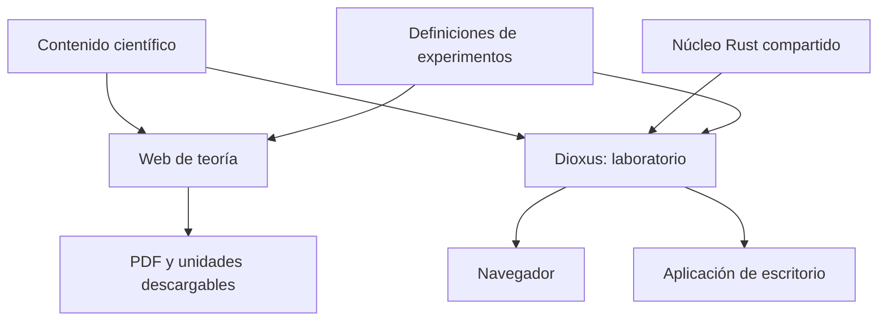
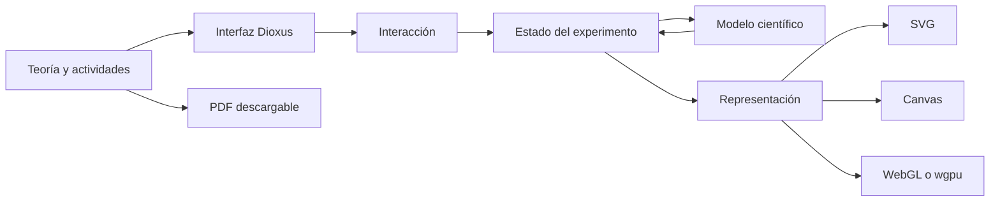

# Guía de desarrollo y arquitectura

Última revisión: 2026-10-20

Esta guía conserva la visión completa de cómo podría construirse el laboratorio
y las razones que sostienen esa dirección. Está pensada como documento de
consulta para el usuario y como contexto para decisiones arquitectónicas futuras.

No es un contrato ni una lista automática de tareas. `AGENTS.md` define la forma
de trabajo, `ESTADO.md` determina la fase y las decisiones vigentes, y `PLAN.md`
ordena la hoja de ruta. Si la experiencia real contradice esta guía, debe
actualizarse explicando qué se ha aprendido.

## Visión general



La teoría y el laboratorio forman un mismo producto educativo, pero no tienen
por qué generarse con la misma herramienta. El laboratorio se ocupa de la
interacción; el sistema editorial se ocupa de textos largos, fórmulas, estructura
didáctica y documentos descargables.

La separación interna de un experimento debe ser igualmente clara:



La representación concreta puede cambiar sin convertir SVG, Canvas o la GPU en
parte del modelo físico o químico.

## 1. Primer objetivo alcanzable

La primera versión del proyecto no debe intentar ser ya el laboratorio completo.
Debe demostrar un recorrido pequeño:

1. portada o catálogo;
2. navegación hasta un experimento;
3. ficha común mínima;
4. explorador de campos integrado;
5. compilación web;
6. comprobación de la posibilidad de escritorio;
7. estructura que permita añadir un segundo experimento sin duplicar toda la
   aplicación.

El segundo experimento será la primera prueba fiable de la arquitectura. Antes
de él, muchas abstracciones solo serían hipótesis.

## 2. Partir de un proyecto nuevo

El laboratorio debe nacer como proyecto nuevo. No conviene transformar
`explorador-campos-dioxus` en la aplicación general, porque su punto de entrada,
estilos y estado fueron diseñados para una única simulación.

La ruta preparada es:

```text
/home/phanaur/github/physia
```

Una organización inicial posible es:

```text
physia/
├── Cargo.toml
├── Cargo.lock
├── AGENTS.md
├── README.md
├── ESTADO.md
├── PLAN.md
├── apps/
│   └── laboratorio/
├── crates/
│   ├── lab-core/
│   ├── lab-ui/
│   └── experimento-campos/
├── contenido/
├── docs/
└── tools/
```

Es una propuesta, no una obligación de crear todos los directorios al principio.

## 3. Responsabilidad de cada parte

### Aplicación `apps/laboratorio`

Contendría el arranque web y de escritorio, rutas, portada, catálogo, navegación,
preferencias globales y montaje de experimentos. No debería contener ecuaciones
específicas de Coulomb, Newton o una reacción química.

### Núcleo `crates/lab-core`

Solo debería recibir conceptos que sean realmente comunes: identificadores,
metadatos, tiempo de simulación, errores de dominio o formatos compartidos de
escena. No es un cajón para cualquier función matemática.

### Interfaz `crates/lab-ui`

Podría contener paneles, controles numéricos, mensajes, botones de reproducción
y el marco visual de un experimento cuando exista reutilización demostrada.
Dependería de Dioxus, pero no de modelos científicos concretos.

### Experimento `crates/experimento-campos`

Contendría el modelo electrostático, estado, interacción, proyección, geometría
de representación, controles y componente Dioxus del explorador.

Esta división debe simplificarse si la primera implementación demuestra que
algunos paquetes no tienen todavía una responsabilidad real.

## 4. Evitar un sistema de plugins prematuro

No hace falta carga dinámica de bibliotecas, registro complejo ni una API
universal. Un catálogo estático y un `match` explícito son suficientes al
principio:

```rust
match experiment_id {
    "campos-electricos" => rsx! { FieldExplorer {} },
    "pendulo-simple" => rsx! { SimplePendulum {} },
    _ => rsx! { ExperimentNotFound {} },
}
```

Es sencillo, visible para el compilador y fácil de aprender. Solo debería
reemplazarse cuando exista un problema concreto que no pueda resolver bien.

## 5. Migrar el explorador por capas

El prototipo Dioxus debe conservarse como referencia mientras se integra.

### Capa 1: núcleo puro

Trasladar matemáticas, física, proyección y geometría SVG junto con sus pruebas,
sin cambiar el comportamiento.

### Capa 2: estado del experimento

Representar escena y parámetros en un tipo independiente de Dioxus:

```rust
pub struct ElectricFieldExperiment {
    pub particles: Vec<Particle>,
    pub pixels_per_meter: f64,
    pub sampling_step_meters: f64,
}
```

El modelo puede exponer operaciones como reiniciar, mover una partícula o
calcular el campo sin recibir eventos del navegador.

### Capa 3: interacción

Separar la política de selección y arrastre de Pointer Events. El navegador
proporciona coordenadas e identidad del puntero; el experimento decide qué se
selecciona y cómo cambia el estado.

### Capa 4: componente

Convertir la pantalla actual en un componente montable dentro de una ruta. El
experimento deja de controlar el arranque global.

### Capa 5: equivalencia

Conservar las pruebas existentes y comparar escenas representativas antes de
declarar sustituido el prototipo.

## 6. Ficha común de experimento

Cada experimento debería resultar reconocible sin obligarlo a tener exactamente
la misma disposición:

```text
┌────────────────────────────────────────────┐
│ Título                     Reiniciar  Ayuda │
├───────────────────────────────┬────────────┤
│                               │ Controles  │
│        Simulación             │ Parámetros │
│                               │ Leyenda    │
├───────────────────────────────┴────────────┤
│ Explicación breve · teoría · actividades   │
└────────────────────────────────────────────┘
```

Los metadatos pueden describir título, resumen, materia, niveles, conceptos y
enlace a teoría. Los textos extensos no deberían formar parte del descriptor.

## 7. Elegir la representación por experimento

### SVG

Adecuado para campos, diagramas de rayos, vectores, circuitos sencillos y escenas
moderadas que deban conservar nitidez. El agrupado de segmentos ya ha resultado
viable en el explorador.

### Canvas 2D

Adecuado para muchas partículas o escenas que cambian completamente en cada
fotograma y no necesitan elementos DOM individuales.

### WebGL o `wgpu`

Reservado para tres dimensiones, grandes cantidades de elementos, sombreadores
o problemas que hayan demostrado superar a Canvas.

No hace falta una abstracción común de renderizador. Lo común debe ser el estado
científico, no necesariamente el método de dibujo.

## 8. Tiempo y animación

Los experimentos estáticos pueden actualizarse de forma síncrona al interactuar.
Las simulaciones continuas deberían separar tiempo real, integración física y
dibujo:

```text
tiempo real
    ↓
acumulador
    ↓
pasos físicos fijos
    ↓
estado del modelo
    ↓
representación
```

Un paso fijo facilita reproducibilidad, pruebas, pausa, avance paso a paso y
comparación entre web y escritorio. `requestAnimationFrame` marca oportunidades
de dibujo, no debería definir por sí solo el resultado físico.

## 9. Unidades

Los modelos deben calcular internamente en el Sistema Internacional. La interfaz
convierte entradas y salidas.

Al principio pueden bastar nombres como `radius_meters` y documentación clara.
Tipos nuevos o una biblioteca de unidades se justifican cuando existan varios
experimentos y conversiones donde el compilador pueda evitar errores reales.

Nunca debe depender del control llamador que un mismo campo represente unas veces
centímetros y otras metros.

## 10. Parámetros y validación

La interfaz no debería introducir texto o números arbitrarios directamente en
el modelo. Conviene separar el estado editable de una configuración científica
válida.

La validación debe poder indicar:

- entrada incompleta;
- formato inválido;
- valor fuera de un intervalo acordado;
- combinación incompatible de parámetros;
- unidad utilizada.

Los errores deben aparecer cerca del control y no convertirse en fallos internos
de la simulación.

## 11. Escenas reproducibles

Una escena debería poder describir su configuración sin incluir estado transitorio
como el puntero que se está arrastrando:

```rust
#[derive(Serialize, Deserialize)]
pub struct ElectricFieldScene {
    pub version: u32,
    pub particles: Vec<ParticleConfig>,
    pub viewport: ViewportConfig,
}
```

Esto permite reinicio, ejemplos preparados, actividades, enlaces compartibles e
importación futura. El campo `version` facilita migrar formatos si evolucionan.

No es necesario implementar serialización en la primera pantalla si todavía no
hay un caso de uso activo.

## 12. Relación entre teoría y laboratorio

La teoría debe vivir en un flujo editorial adecuado para texto, fórmulas,
referencias y PDF. El laboratorio debe ofrecer interacción. En una publicación
futura podrían convivir así:

```text
/                    portada
/laboratorio/        aplicación Dioxus
/teoria/             contenido editorial
/descargas/          PDF y materiales
```

Las rutas estables permitirían que una actividad abra una escena concreta y que
el experimento vuelva a la explicación correspondiente.

Quarto y Typst siguen siendo opciones por evaluar. La elección debe basarse en
un recorrido vertical pequeño, no en intentar publicar todo el temario.

## 13. Estado global reducido

El estado global debería limitarse a preferencias realmente comunes, como tema,
idioma, movimiento reducido o formato decimal. Cada experimento conserva su
estado científico y de interacción.

Una gran estructura global aumentaría el acoplamiento y haría que cambios en
química, óptica o mecánica se afectaran entre sí.

## 14. Accesibilidad desde el principio

El proyecto educativo debería contemplar:

- controles utilizables con teclado cuando sea viable;
- etiquetas asociadas a entradas;
- descripción textual de la escena;
- contraste suficiente;
- información que no dependa solo del color;
- preferencia de movimiento reducido;
- objetivos táctiles razonables;
- reinicio y valores numéricos accesibles fuera del dibujo.

No es útil convertir miles de segmentos SVG en miles de elementos narrados por
un lector de pantalla. Es mejor resumir la escena, cargas, parámetros y valores
seleccionados.

## 15. Estrategia de pruebas

### Núcleo

Probar operaciones matemáticas, leyes físicas o químicas, conservación,
simetrías, transformaciones, singularidades y límites.

### Experimento

Probar estado inicial, reinicio, cambio de parámetros, serialización y operaciones
de interacción separables de la interfaz.

### Equivalencia

Durante la migración del explorador, mantener las pruebas y el comprobador de
escenas hasta demostrar que el laboratorio conserva los resultados.

### Interfaz

Probar únicamente recorridos importantes: abrir la ruta correcta, modificar el
estado mediante controles y restablecer la escena. Evitar instantáneas HTML
frágiles que solo reflejen detalles internos.

## 16. Rendimiento y presupuestos

Unos objetivos iniciales orientativos, revisables tras medir dispositivos reales:

| Aspecto | Objetivo inicial |
|---|---:|
| Descarga web comprimida | menos de 1 MB |
| Tarea de interacción | evitar bloqueos superiores a 50 ms |
| Animación prevista | aspirar a 60 Hz en un portátil corriente |
| Inicio con recursos en caché | rápido y sin trabajo científico innecesario |

Los números no son garantías contractuales. Sirven para detectar regresiones y
obligar a medir antes de introducir complejidad.

## 17. Cuándo usar workers

El cálculo debe permanecer en el hilo principal mientras termine con holgura y
no bloquee entrada ni dibujo. Un worker se justifica cuando un perfil muestre
cálculo repetido que produce pausas perceptibles.

La separación entre comandos, modelo puro y resultados serializables prepara esa
migración sin imponerla desde el principio.

## 18. Salida de escritorio

Las diferencias de plataforma deben concentrarse en la aplicación o una pequeña
capa de adaptación. El modelo y la mayor parte de los componentes deberían ser
comunes.

Las características de Cargo pueden separar `web` y `desktop`. No debe suponerse
que «compila» significa que la ventana y toda la interacción se han probado. Las
dependencias de sistema necesarias deben documentarse por plataforma.

## 19. Orden de implementación

1. Crear el workspace y la aplicación mínima.
2. Añadir portada, catálogo y ruta vacía de experimento.
3. Migrar campos por capas y demostrar equivalencia.
4. Extraer solo infraestructura común ya necesaria.
5. Construir un segundo experimento con animación.
6. Crear una unidad breve de teoría, actividad y PDF.
7. Añadir un experimento de química con necesidades distintas.
8. Revisar arquitectura y publicación con evidencia de varios casos.

Este orden puede cambiar en `ESTADO.md` si el aprendizaje o una prioridad docente
lo aconsejan.

## 20. Papel de los proyectos existentes

Los prototipos en Rust, C#, Go, Dioxus, egui y Leptos son referencias y evidencia
de la elección tecnológica. No deberían convertirse en dependencias ni borrarse
durante la migración.

El código validado se traslada al laboratorio de manera controlada. Cuando el
nuevo experimento alcance equivalencia, el prototipo Dioxus puede marcarse como
congelado, conservando su historial.

## 21. Hitos concretos

### Hito 1 — Aplicación vacía

Web y posible escritorio, portada, catálogo, ruta de experimento y tema mínimo.

### Hito 2 — Explorador integrado

Mismo modelo, SVG, arrastre, diseño adaptable, pruebas y equivalencia.

### Hito 3 — Simulación animada

Pausa, reinicio, paso fijo, velocidad y gráfica temporal. El péndulo es una
propuesta, no una decisión confirmada.

### Hito 4 — Unidad educativa

Teoría, PDF, actividad, escena enlazada y navegación coherente.

### Hito 5 — Experimento de química

Formularios, validación, unidades, tabla o gráfica y revisión de las abstracciones
compartidas.

Después de estos hitos habría evidencia suficiente para estabilizar APIs y
decisiones de publicación.

## 22. Recomendación práctica

La dirección propuesta es comenzar con un proyecto nuevo y una estructura mínima:

```text
physia/
├── apps/laboratorio
├── crates/lab-core
├── crates/lab-ui
├── crates/experimento-campos
└── contenido
```

No es necesario crearla completa el primer día. La regla que resume la
arquitectura es:

> El laboratorio organiza; cada experimento modela; la interfaz representa; la
> teoría explica.

El primer paso de código debería crear una aplicación Dioxus mínima y una ruta
vacía para campos. Después se traslada el núcleo con sus pruebas y finalmente la
interfaz. Así el laboratorio nace con una estructura general sin perder la
referencia exacta del prototipo.

## Cómo utilizar esta guía

- Para saber qué hacer ahora, consulta `../ESTADO.md`.
- Para conocer las fases y sus criterios de salida, consulta `../PLAN.md`.
- Para entender la razón de una separación o decisión arquitectónica, vuelve a
  esta guía.
- Cuando una experiencia real invalide una recomendación, actualiza la guía y
  registra la decisión vigente en `ESTADO.md`.
